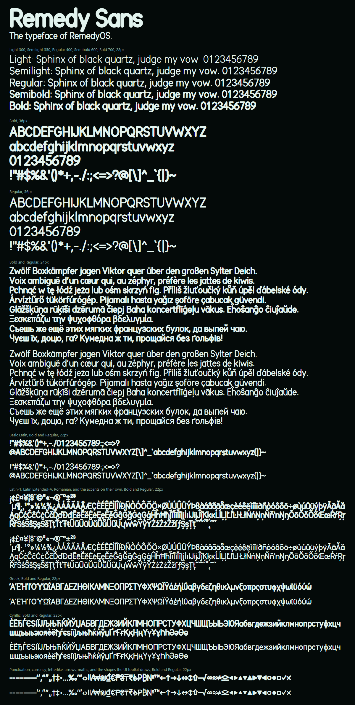

# Remedy Sans

Remedy Sans is the typeface of RemedyOS.
A geometric sans in Regular and Bold, drawn as strokes with round terminals.

Version 1.110. The last published release is [v1.0.0](https://github.com/AhmiDarrow/RemedySans/releases/tag/v1.0.0) (font version 1.000, Basic Latin only).



## What's here

| Path | What it is |
|---|---|
| `fonts/` | Ready-to-use files: `RemedySans-Regular` and `RemedySans-Bold`, each as `.ttf`, `.otf` and `.woff2`. The `.ttf` and `.woff2` are hinted with ttfautohint (stems snap to whole pixels); the `.otf` carries PostScript hints from otfautohint |
| `source/remedy-sans.strokes` | The source. Every character drawn as strokes on a 24-unit grid |
| `build.py` | Turns the stroke file into the font files |
| `check.py` | Checks advances, holes, and that both weights share one set of metrics |
| `specimen.html` | Open in a browser to see every character |
| `LICENSE` | SIL Open Font License 1.1 |
| `CHANGELOG.md` | Release history |

## Using it on a web page

```css
@font-face {
  font-family: "Remedy Sans";
  src: url("fonts/RemedySans-Regular.woff2") format("woff2");
  font-weight: 400;
}
@font-face {
  font-family: "Remedy Sans";
  src: url("fonts/RemedySans-Bold.woff2") format("woff2");
  font-weight: 700;
}
h1 { font: 700 64px/1.15 "Remedy Sans", sans-serif; }
```

## Using it on the desktop

Install `RemedySans-Regular.ttf` and `RemedySans-Bold.ttf` (or the two `.otf` files; install one format, not both). On Windows, select both files, right-click, and choose Install. On macOS, open them in Font Book and choose Install. The family name is Remedy Sans. Bold is the bold style of that family.

The zip on the [release](https://github.com/AhmiDarrow/RemedySans/releases/tag/v1.0.0) has those files, the web fonts, this readme, and the specimen.

## Characters

584 characters in each weight, the same set in Regular and Bold:

- Basic Latin, Latin-1 Supplement and Latin Extended-A in full (Western, Central European, Baltic, Turkish, Maltese, Welsh, Esperanto), plus Romanian Ș ș Ț ț, ƒ, and dotless ȷ
- The accents on their own: ˆ ˇ ˘ ˙ ˚ ˛ ˜ ˝ ´ ¨ ¯ ¸
- Modern monotonic Greek, with tonos and dialytika
- Cyrillic U+0400 to U+045F (Russian, Ukrainian, Belarusian, Bulgarian, Serbian, Macedonian) and Ґ ґ Ғ ғ Қ қ Ң ң Ү ү Ұ ұ Һ һ Ә ә Ө ө (Kazakh and Central Asian)
- General punctuation: dashes, curly quotes, daggers, bullet, ellipsis, per mille, primes, single guillemets, ‼, fraction slash
- Spaces with their proper widths: no-break, figure, punctuation, thin, hair, narrow no-break
- Currency € ₹ ₽ ₺ ₩ ₪ ₫ ₱ ₴ ₸ ₿, letterlike ™ №, arrows ← ↑ → ↓ ↔ ↕ ⇧, maths − ∞ √ ≈ ≠ ≤ ≥
- Shapes a UI draws: ◻ ▲ ▼ ► ◄ ⏴ ⏵ ⏶ ⏷ ✓ ✗ ● ○

U+00A0 no-break space uses the same empty glyph as the space, so a line will not break there. No emoji, and no scripts that need shaping (Arabic, Hebrew, Indic) or very large sets (CJK).

The drawing grid is 24 units tall: baseline 0, x-height 14, cap height 20, ascender 21, descender -6. Regular is stroke weight 3.0 and Bold is 4.3, both with round caps and round joins. The font is proportional (digits share one width) at 1000 units per em. Line spacing is the same as in 1.000 and shared by both weights: ascent 1048, descent -340, no line gap, in both the hhea and the typo metrics, with USE_TYPO_METRICS set. Accents on capitals may rise above that ascent, as in most fonts. The Windows metrics (usWinAscent 1312, usWinDescent 416) cover every glyph, so nothing is clipped.

Accented letters are not drawn one by one. Each accent is drawn once in the stroke file as a `mark`, each base letter says where marks sit with `anchor` lines, and a line such as `glyph U+00C1 = U+0041 + acute` builds Á. The build lifts a mark clear of the letter by one stroke weight plus a fixed gap, so the space between accent and letter looks the same in Regular and Bold. Greek and Cyrillic letters that look like Latin ones reuse the Latin drawing (`glyph U+0410 = U+0041`).

## Changing a letter

1. Edit its strokes in `source/remedy-sans.strokes`. The comments at the top of that file explain the commands.
2. Rebuild:

```bash
pip install fonttools brotli skia-pathops ttfautohint-py afdko
python build.py
python check.py
```

`build.py` expands every stroke to a filled outline, removes the overlaps, hints them, and writes the `.ttf`, `.woff2` and `.otf` files. Advance widths come from the stroke file and are the same in both weights. Changing a base letter or a mark changes every accented letter built from it.

`check.py` also checks that every character on the list above is present in both weights, that every character except the spaces has an outline, that no accent touches its letter, that the line spacing still equals 1.000's, and that the Windows metrics cover every glyph.

## About

Remedy Sans is the typeface of RemedyOS.

Hope this helps
- Ahmi

## License

Remedy Sans is licensed under the [SIL Open Font License, Version 1.1](LICENSE). You can use it freely in personal and commercial projects, embed it in apps and websites, and modify or redistribute it under the same license. The font itself may not be sold on its own. There is no Reserved Font Name.
